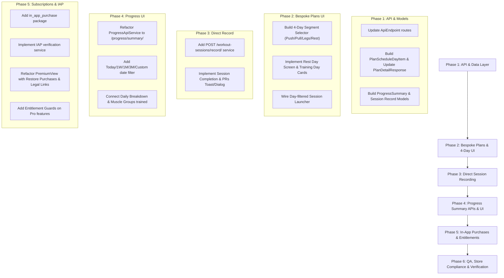

# HYKX Mobile Implementation Plan: Bespoke Workouts, Direct Recording, Progress Summary & Subscriptions

**Document Version:** 1.0  
**Target Project:** `hawiisaac-main 2` (Flutter / GetX / Dart)  
**Reference Guides:** 
- `developer-guide-bespoke-workouts-and-updates.md` (API v2.1)
- `developer-guide-inapp-purchases.md` (IAP v2.0)

---

## Table of Contents
1. [Architecture Overview & Migration Roadmap](#1-architecture-overview--migration-roadmap)
2. [Module 1: Bespoke Workout Plans & 4-Day Cycle UI/API](#2-module-1-bespoke-workout-plans--4-day-cycle-uiapi)
3. [Module 2: Direct Workout Session Recording](#3-module-2-direct-workout-session-recording)
4. [Module 3: Progress Summary & Analytics Integration](#4-module-3-progress-summary--analytics-integration)
5. [Module 4: In-App Purchases & Entitlement Management (StoreKit & Play Billing)](#5-module-4-in-app-purchases--entitlement-management-storekit--play-billing)
6. [Complete Step-by-Step Implementation Sequence](#6-complete-step-by-step-implementation-sequence)
7. [Testing, QA & Store Compliance Checklist](#7-testing-qa--store-compliance-checklist)

---

## 1. Architecture Overview & Migration Roadmap

```
┌────────────────────────────────────────────────────────────────────────┐
│                          HYKX Flutter App Layer                        │
├──────────────────┬──────────────────┬──────────────────┬───────────────┤
│  Bespoke Plans   │  Direct Session  │ Progress Summary │ Subscriptions │
│  4-Day Split UI  │  Record Flow     │ Analytics UI     │ & Entitlement │
├──────────────────┴──────────────────┴──────────────────┴───────────────┤
│                         Controllers (GetX)                             │
│  - BespokePlanController          - ProgressController                 │
│  - AiExerciseSessionController    - SubscriptionController             │
├────────────────────────────────────────────────────────────────────────┤
│                       Services & API Clients                           │
│  - PlanApiService                 - ProgressApiService                 │
│  - LogginApiService               - InAppPurchaseService               │
│                                   - SubscriptionApiService             │
├────────────────────────────────────────────────────────────────────────┤
│                      Backend REST Endpoints (v2.1)                     │
│  /api/v1/plans/                   /api/v1/workout-sessions/record/     │
│  /api/v1/plans/{id}/              /api/v1/progress/summary/            │
│  /api/v1/plans/{id}/days/{day}/   /api/subscriptions/status/           │
│  /api/subscriptions/plans/        /api/subscriptions/{store}/verify/   │
└────────────────────────────────────────────────────────────────────────┘
```

---

## 2. Module 1: Bespoke Workout Plans & 4-Day Cycle UI/API

### 2.1 Backend Contract Summary
- `GET /api/v1/plans/` (Query: `location=gym|home`, `goal=...`, `level=...`)
- `GET /api/v1/plans/{id}/` (Optional query: `?day=1|2|3|4|push|pull|legs|rest`)
- `GET /api/v1/plans/{id}/schedule/`
- `GET /api/v1/plans/{id}/days/{day}/`

### 2.2 Data Models to Update / Create
File: `lib/features/home/model/plan_detail_model.dart`

```dart
class PlanScheduleDayItem {
  final int id;
  final int dayNumber;
  final String dayName;        // "Day 1"
  final String splitName;      // "Push", "Pull", "Legs", "Rest"
  final String title;          // "Day 1: Push"
  final String focus;          // "Chest, shoulders, triceps"
  final bool isRestDay;
  final String restNote;
  final int order;
  final int exerciseCount;
  final List<PlanExerciseItem> exercises;

  PlanScheduleDayItem({
    required this.id,
    required this.dayNumber,
    required this.dayName,
    required this.splitName,
    required this.title,
    required this.focus,
    this.isRestDay = false,
    this.restNote = '',
    this.order = 1,
    this.exerciseCount = 0,
    this.exercises = const [],
  });

  factory PlanScheduleDayItem.fromJson(Map<String, dynamic> json) {
    final exList = json['exercises'] as List<dynamic>? ?? [];
    return PlanScheduleDayItem(
      id: json['id'] is num ? (json['id'] as num).toInt() : 0,
      dayNumber: json['day_number'] is num ? (json['day_number'] as num).toInt() : 1,
      dayName: json['day_name']?.toString() ?? '',
      splitName: json['split_name']?.toString() ?? '',
      title: json['title']?.toString() ?? '',
      focus: json['focus']?.toString() ?? '',
      isRestDay: json['is_rest_day'] == true,
      restNote: json['rest_note']?.toString() ?? '',
      order: json['order'] is num ? (json['order'] as num).toInt() : 1,
      exerciseCount: json['exercise_count'] is num ? (json['exercise_count'] as num).toInt() : exList.length,
      exercises: exList
          .whereType<Map<String, dynamic>>()
          .map((e) => PlanExerciseItem.fromJson(e))
          .toList(),
    );
  }
}

// Enhance PlanDetailResponse to support schedule & metadata
class PlanDetailResponse {
  final int id;
  final String title;
  final String description;
  final String? image;
  final String location;            // "gym" or "home"
  final int totalDays;              // 4
  final int exerciseCount;          // 30
  final int durationMinutes;
  final String durationDisplay;
  final String level;
  final String levelDisplay;
  final int estimatedCalories;
  final int caloriesBurn;
  final String equipmentNote;
  final List<PlanScheduleDayItem> schedule; // 4-day schedule
  final List<PlanExerciseItem> exercises;   // Fallback flat list or day filtered list

  // ... fromJson factory with schedule parsing
}
```

### 2.3 API Endpoint & Service Changes
1. **`lib/core/apiendpoint/apiendpoint.dart`**:
   ```dart
   static String plans({String? location, String? goal, String? level}) {
     final q = <String>[
       if (location != null) 'location=$location',
       if (goal != null) 'goal=$goal',
       if (level != null) 'level=$level',
     ];
     return '$baseUrl/plans/${q.isEmpty ? '' : '?${q.join('&')}'}';
   }

   static String planById(int id, {dynamic day}) {
     final dayParam = day != null ? '?day=$day' : '';
     return '$baseUrl/plans/$id/$dayParam';
   }

   static String planSchedule(int id) => '$baseUrl/plans/$id/schedule/';
   static String planDay(int id, dynamic day) => '$baseUrl/plans/$id/days/$day/';
   ```
2. **`lib/features/home/services/plan_api_service.dart`**:
   - Add `getPlans({String? location, String? goal, String? level})`
   - Update `getPlanById(int id, {dynamic day})`
   - Add `getPlanDay(int id, dynamic day)`

### 2.4 UI Updates: 4-Day Cycle Plan Screen
Transform `WarmUpDetailsScreen` into a full Bespoke Plan View:
1. **Header:** Location Badge (`Gym` or `Home`), Program title, 4-Day Split subtitle, Duration, Total Cal Burn.
2. **Day Selector Tabs (Segmented Indicator):**
   - `[ Day 1: Push ]`  `[ Day 2: Pull ]`  `[ Day 3: Legs ]`  `[ Day 4: Rest ]`
3. **Day Detail Content Area:**
   - **For Training Days (1, 2, 3):**
     - Target Focus Chip (e.g. `Chest, shoulders, triceps`).
     - Exercise Count (`10 exercises`).
     - Exercise Cards displaying: Exercise Name, Muscle Group, Modality (Free weights/dumbbell), Set & Reps recommendations.
     - "Start Day X Workout" floating/bottom button.
   - **For Rest Day (Day 4):**
     - Rest & Recovery illustration/icon.
     - Title: "Rest / Active Recovery".
     - Rest Notes & Recovery Recommendations (Hydration, light stretching, foam rolling, sleep).
     - Informational button: "Log Rest Day" or "Repeat Cycle".

---

## 3. Module 2: Direct Workout Session Recording

### 3.1 Backend Contract Summary
- `POST /api/v1/workout-sessions/record/`
- Request:
  ```json
  {
    "plan_id": 61,
    "workout_day": "Day 1: Push",
    "day_number": 1,
    "workout_date": "2026-11-01",
    "duration_minutes": 45,
    "calories_burned": 280,
    "note": "Optional note",
    "exercises": [
      {
        "workout_id": 41,
        "custom_title": "Alternating Dumbbell Bench Press",
        "sets": [
          { "set_number": 1, "weight_kg": 20.0, "reps": 12, "is_completed": true }
        ]
      }
    ]
  }
  ```

### 3.2 Model & Service Implementation
File: `lib/features/loggin/model/record_workout_session_models.dart`
- Create `RecordWorkoutSessionRequest`, `RecordExerciseItem`, `RecordSetItem`.
- Create `RecordWorkoutSessionResponse` parsing server-calculated values: `total_volume`, `current_streak`, `longest_streak`, `prs_achieved`.

File: `lib/features/loggin/services/loggin_api_service.dart`
- Add:
  ```dart
  Future<RecordWorkoutSessionResponse> recordWorkoutSession(
    RecordWorkoutSessionRequest request,
  ) async {
    final url = ApiEndpoint.recordWorkoutSession;
    final data = await _apiClient.post(
      url: url,
      body: request.toJson(),
      headers: _authHeaders,
      logLabel: 'POST /workout-sessions/record/',
    );
    return RecordWorkoutSessionResponse.fromJson(data);
  }
  ```

### 3.3 UI Integration
- In `AiExerciseSessionController`:
  - When user finishes an active session, provide a reliable fallback to submit the entire session via `recordWorkoutSession` if active WebSocket or step-by-step API dropped network packets.
  - Show a celebratory post-workout modal highlighting:
    - Total Volume Lifted (kg)
    - Calories Burned
    - Current Streak increment
    - New PRs achieved during the session.

---

## 4. Module 3: Progress Summary & Analytics Integration

### 4.1 Backend Contract Summary
- `GET /api/v1/progress/summary/`
- Query parameters:
  - `date`: specific date `YYYY-MM-DD` (for single day summary)
  - `period`: `today`, `1w`, `1m`, `3m`, `custom`
  - `start_date` / `end_date` (for custom period)

### 4.2 Models to Create
File: `lib/features/progress/model/progress_summary_model.dart`
```dart
class ProgressSummaryModel {
  final String period;
  final bool isSingleDay;
  final String dateRangeDisplay;
  final int workoutsCount;
  final int exerciseCount;
  final int totalDurationMinutes;
  final double totalVolumeKg;
  final String totalVolumeDisplay;
  final int totalSets;
  final int caloriesBurned;
  final List<String> muscleGroupsTrained;
  final List<DailyBreakdownItem> dailyBreakdown;
  final List<SessionSummaryItem> sessions;
  final int bestStreakDays;
  // ... fromJson
}
```

### 4.3 Endpoint & Service Refactoring
1. **Fix `ApiEndpoint`:**
   - Change `static String progress` to point to `/progress/summary/` instead of `/parogress/`.
   - Add query builder supporting `date`, `period`, `start_date`, `end_date`.
2. **Refactor `ProgressApiService`:**
   - Update `getProgressSummary({String? date, String period = '1w', String? startDate, String? endDate})`.

### 4.4 UI Integration in `ProgressScreen` & `ProgressShareDialog`
- **Filter Tabs:** Update filter tabs to include `Today`, `1W`, `1M`, `3M`, and Date Picker for `Custom`.
- **Muscle Groups Trained Badge Cloud:** Display chips for muscle groups trained during the selected period (`Chest`, `Back`, `Legs`, etc.).
- **Daily Breakdown List:** Render a day-by-day bar or card list showing volume, workout count, and sets for each day.
- **Completed Sessions List:** Display the list of sessions logged in the period with direct tap to view session recap.
- **Progress Share Card:** Bind real `workouts_count`, `total_duration_minutes`, `total_volume_display`, and `muscle_groups_trained` directly to the transparent PNG share generator.

---

## 5. Module 4: In-App Purchases & Entitlement Management (StoreKit & Play Billing)

### 5.1 Architecture & Strategy
- Mobile stores (Google Play & Apple App Store) mandate **Native In-App Purchases** for digital fitness plans and subscriptions.
- Keep Stripe strictly for web or direct external billing if required, but Android and iOS native builds must use StoreKit 2 and Google Play Billing.

### 5.2 Store Product IDs & Backend Verification
| Plan | Tier | Google Play Product ID | Apple App Store Product ID |
|---|---|---|---|
| **HYKX Pro Monthly** | PRO | `hykx_pro_monthly` | `hykx_pro_monthly` |
| **HYKX Pro Yearly** | PRO | `hykx_pro_yearly` | `hykx_pro_yearly` |

Endpoints:
- `GET /api/subscriptions/status/`: Check user entitlements & subscription state
- `GET /api/subscriptions/plans/`: Fetch localized backend plan pricing & features
- `POST /api/subscriptions/google-play/verify/`: Validate Google Play purchase token
- `POST /api/subscriptions/apple/verify/`: Validate Apple original transaction ID

### 5.3 Step-by-Step Implementation

#### Step 1: Add Dependency
Add official Flutter In-App Purchase package in `pubspec.yaml`:
```yaml
dependencies:
  in_app_purchase: ^3.2.0
```

#### Step 2: Create Subscription Service & API Client
File: `lib/features/profile/services/subscription_api_service.dart`
- `Future<SubscriptionStatusResponse> getSubscriptionStatus()`
- `Future<List<SubscriptionPlan>> getAvailablePlans()`
- `Future<bool> verifyGooglePlayPurchase({...})`
- `Future<bool> verifyApplePurchase({...})`

File: `lib/core/services/iap_service.dart`
- Initializes `InAppPurchase.instance`
- Listens to `purchaseStream`
- Handles `PurchaseStatus.purchased`: calls backend verification -> on success calls `completePurchase()`
- Handles `PurchaseStatus.restored`: verifies with backend -> updates state
- Implements `restorePurchases()`

#### Step 3: Global Entitlement State (GetX)
File: `lib/features/profile/controller/user_subscription_controller.dart`
```dart
class UserSubscriptionController extends GetxController {
  final RxBool isPremium = false.obs;
  final RxList<String> entitlements = <String>[].obs;
  final Rxn<SubscriptionDetails> activeSubscription = Rxn<SubscriptionDetails>();

  bool hasEntitlement(String entitlement) {
    return isPremium.value && entitlements.contains(entitlement);
  }
}
```

#### Step 4: Redesign `PremiumView` UI
- Remove static Stripe card payment flow.
- Display store localized prices from StoreKit / Play Billing.
- Include Google Play / Apple required legal elements:
  - "Subscription auto-renews unless canceled at least 24 hours before current period ends."
  - Links to **Terms of Service** and **Privacy Policy**.
  - **"Restore Purchases"** button.
- Feature gating throughout the app:
  - When non-premium user taps on a Bespoke 4-day plan, AI scanner, or detailed progress analytics, trigger a paywall sheet or route to `PremiumView`.

---

## 6. Complete Step-by-Step Implementation Sequence



---

## 7. Testing, QA & Store Compliance Checklist

### 7.1 Bespoke Plans & Schedules
- [ ] Verify Day 1 (Push), Day 2 (Pull), Day 3 (Legs), and Day 4 (Rest) load correctly with real backend data.
- [ ] Confirm switching between days shows correct exercises, target muscles, and modalities.
- [ ] Confirm Day 4 (Rest) renders recovery instructions and disables exercise launch.
- [ ] Test filtering by `location=gym` and `location=home`.

### 7.2 Session Recording
- [ ] Complete a workout and submit via `/api/v1/workout-sessions/record/`.
- [ ] Verify backend response returns accurate `total_volume`, increments user streak, and checks PRs.

### 7.3 Progress Summary
- [ ] Query summary for single day (`?date=YYYY-MM-DD`).
- [ ] Query preset ranges: `today`, `1w`, `1m`, `3m`.
- [ ] Check volume display formatting (e.g. `3,200 kg`) and muscle groups chips.
- [ ] Verify image export in `ProgressShareDialog` matches summary data.

### 7.4 In-App Purchases & Apple/Google Review Compliance
- [ ] Test purchase in Google Play Internal Testing track with licensed test account.
- [ ] Test purchase in Apple TestFlight with Sandbox Apple ID.
- [ ] Verify server-side receipt validation updates `/api/subscriptions/status/` to `is_premium: true`.
- [ ] Confirm "Restore Purchases" restores previous valid transactions.
- [ ] Ensure Terms of Use (EULA) and Privacy Policy links are prominent in the purchase flow (mandatory for App Store approval).
